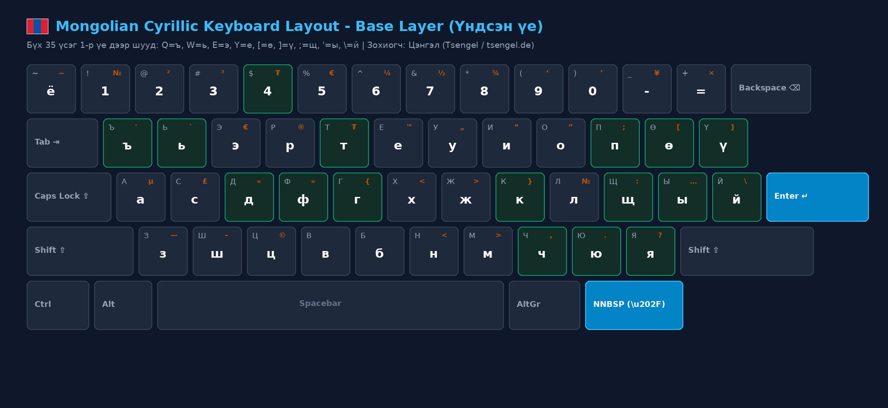
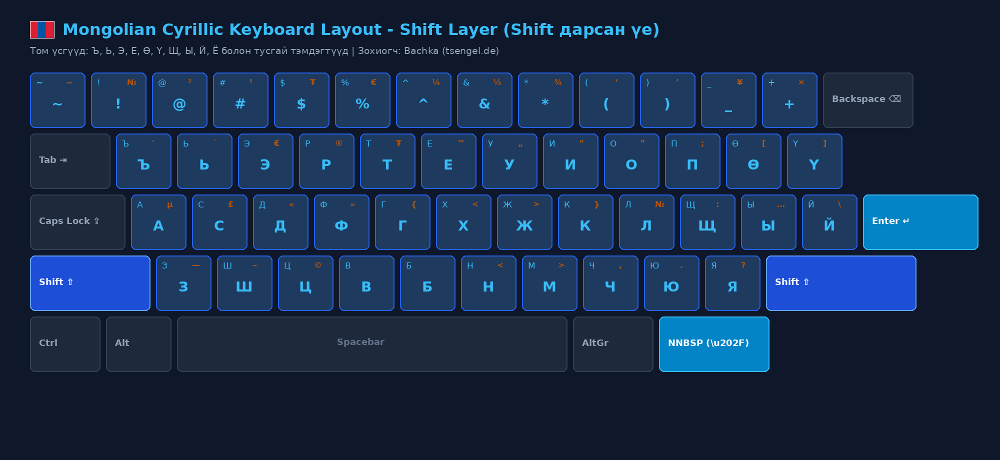
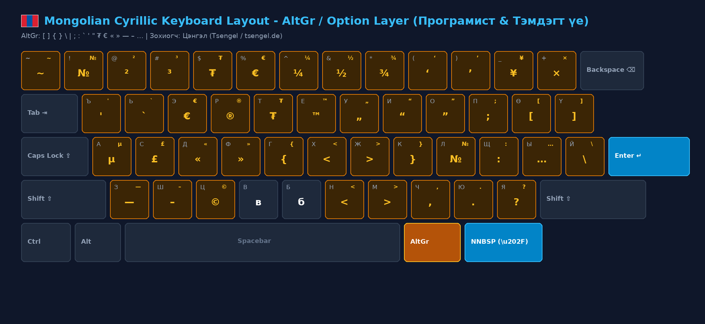
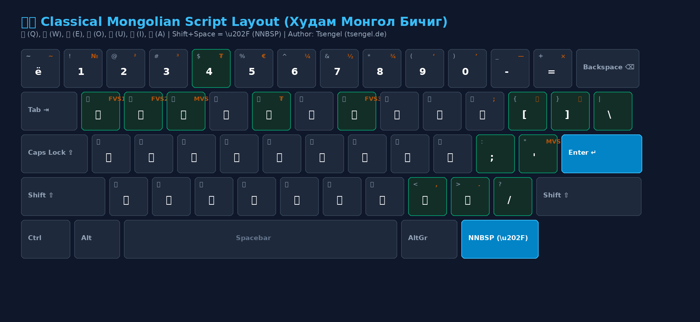

# 🇲🇳 Universelles mongolisches Tastaturlayout
### Für Linux • macOS • Windows • Web

[](LICENSE)
[]()
[]()
[](https://ko-fi.com/tsengel)
[-red.svg)](https://tsengel.de)

**Sprachen:** [🇲🇳 Монгол](README.md) • [🇬🇧 English](README.en.md) • [🇩🇪 Deutsch](README.de.md)

> **„Auf Mongolisch zu tippen sollte niemals mühsam, langsam oder frustrierend sein.“**  
> Eine einheitliche, ergonomische Hochgeschwindigkeits-Tastatursuite für Mongolinnen und Mongolen weltweit, Diaspora-Gemeinschaften, Entwickler und Sprachbegeisterte – optimiert für US-QWERTY- und deutsche QWERTZ-Tastaturen.

---

## 🗺️ Layout-Übersichten (Alle Ebenen visualisiert)

### 1. Basisebene (Alle 35 mongolischen kyrillischen Buchstaben direkt erreichbar)
> **Grundprinzip**: Kein AltGr oder Option erforderlich. `Q = ъ`, `W = ь`, `Y = е`, `[ = ө`, `] = ү`, `; = щ`, `' = ы`, `\ = й`, `` ` = ё `` liegen direkt auf Ebene 1.



### 2. Shift-Ebene (Großbuchstaben & Satzzeichen)
> Großbuchstaben (**`Ө, Ү, Ъ, Ь, Е, Щ, Ы, Й, Ё`**) und Sonderzeichen.



### 3. AltGr- / Option-Erweiterungsebene (Programmierklammern & offizielle Symbole)
> Das Halten der **rechten Alt-Taste (AltGr)** bzw. der **macOS Wahltaste (Option)** bietet sofortigen Zugriff auf Programmierklammern (**`[ ] { } \ | ; : ' "`**), das offizielle Tugrik-Währungssymbol (**`₮`**), Euro (**`€`**), Anführungszeichen (**`« »`**) und den Gedankenstrich (**`—`**).



### 4. Traditionelle mongolische Schrift (Hudam Mongol Bichig — Bachka Phonetik)
> Phonetisches Layout mit 100% übereinstimmendem Muskelgedächtnis: `[` = **ᠥ (Ö)**, `]` = **ᠦ (Ü)**, `E` = **ᠡ (E)**, `O` = **ᠣ (O)**, `U` = **ᠤ (U)**, `I` = **ᠢ (I)**, `A` = **ᠠ (A)**, `N` = **ᠨ (N)**, `Shift+N` = **ᠩ (Ag/Ng)**. Die Ziffernreihe tippt traditionelle Ziffern (᠐-᠙). `Umschalt + Leertaste` = **NNBSP** (`\u202F`).



---

## ⌨️ Tastenbelegung & Referenztabelle

| Taste | Basisebene (Ebene 1) | Shift-Ebene (Ebene 2) | AltGr / Option (Ebene 3) | Anmerkung |
|:---:|:---:|:---:|:---:|:---|
| `Q` | **ъ** | **Ъ** | `'` | Direkt auf Basisebene |
| `W` | **ь** | **Ь** | `` ` `` | Direkt auf Basisebene |
| `E` | **э** | **Э** | `€` | Euro-Zeichen |
| `R` | **р** | **Р** | `®` | Registriert |
| `T` | **т** | **Т** | **₮ (U+20AE)** | Tugrik |
| `Y` | **е** | **Е** | `™` | **"е / Е" liegt hier!** |
| `[` | **ө** | **Ө** | `[` | **ө auf Basis, [ auf AltGr** |
| `]` | **ү** | **Ү** | `]` | **ү auf Basis, ] auf AltGr** |
| `;` | **щ** | **Щ** | `:` | **щ auf Basis, : auf AltGr** |
| `'` | **ы** | **Ы** | `…` | **ы auf Basis, … auf AltGr** |
| `\` | **й** | **Й** | `\` | **й auf Basis, \ auf AltGr** |
| `` ` `` | **ё** | **Ё** | `~` | **ё auf Basis, ~ auf AltGr** |
| `G` | **г** | **Г** | `{` | Geschweifte Klammer links |
| `K` | **к** | **К** | `}` | Geschweifte Klammer rechts |
| `D` | **д** | **Д** | `«` | Anführungszeichen links |
| `F` | **ф** | **Ф** | `»` | Anführungszeichen rechts |
| `4` | 4 | $ | **₮** | Tugrik |
| `-` | - | _ | **—** | Gedankenstrich |
| `,` | **ч** | **Ч** | `,` | **ч auf Basis, Komma auf AltGr** |
| `.` | **ю** | **Ю** | `.` | **ю auf Basis, Punkt auf AltGr** |
| `/` | **я** | **Я** | `?` | **я auf Basis, Fragezeichen auf AltGr** |
| `Leertaste` | Leerzeichen | Leerzeichen | `\u202F` | **NNBSP (Schmales geschütztes Leerzeichen)** |

---

## Installationsanleitungen

### 🐧 1. Linux (Ubuntu, Debian, Fedora, Arch)
Ein einziger Befehl installiert **alle 3 Editionen gleichzeitig** in das systemweite XKB-Verzeichnis:

```bash
cd linux
sudo ./install.sh
```

Nach der Installation stehen beide Layouts sofort zur Verfügung:
1. **Standard**: `Mongolian Cyrillic (Bachka)` — Alle 35 Buchstaben direkt erreichbar (`Q=ъ, W=ь, Y=е, [=ө, ]=ү`)
2. **Traditionelle Schrift**: `Mongolian Script (Bachka)` — Phonetische Zuordnung (`[=ᠥ, ]=ᠦ, A=ᠠ, E=ᠡ...`)

* **Terminal-Umschaltung (X11)**:
  - `setxkbmap mn` (Mongolisches Kyrillisch)
  - `setxkbmap mn -variant bichig` (Traditionelle Schrift)
* **Desktop (GNOME / Ubuntu / Fedora)**:
  - Öffnen Sie `Einstellungen` $\rightarrow$ `Tastatur` $\rightarrow$ `Eingabequellen` $\rightarrow$ `+` (Hinzufügen) $\rightarrow$ `Mongolisch`. Umschalten jederzeit mit **`Super (Win) + Leertaste`**.
* **Deinstallation / Wiederherstellung**: `cd linux && sudo ./uninstall.sh`.

---

### 🍏 2. macOS (Apple OS X / macOS)
Offizielles Apple-Standard `Mongolian.bundle` und Installationsprogramm für macOS:

* **Installation über Disk Image (.dmg — Empfohlene 1-Klick-Methode)**:
  1. Öffnen Sie `Mongolian-Keyboard-macOS-v1.0.3.dmg` per Doppelklick.
  2. Öffnen Sie darin **`Keyboard Installer.app`** und ziehen Sie **`Mongolian.bundle`** in das Fenster der App.
  3. *(Manuelle Installation)*: Öffnen Sie den Finder, drücken Sie **Cmd + Shift + G**, geben Sie `~/Library/Keyboard Layouts` ein und kopieren Sie `Mongolian.bundle` oder `MongolianCyrillicErgonomic.keylayout` hinein.
  4. **WICHTIG: Melden Sie sich unbedingt einmal von macOS ab und wieder an (oder starten Sie den Mac neu)**. macOS kompiliert und lädt Tastaturlayouts nur beim Anmelden in den Speicher.
* **Aktivierung in macOS**:
  1. Öffnen Sie `Systemeinstellungen` $\rightarrow$ `Tastatur` $\rightarrow$ `Texteingabe` (Eingabequellen) $\rightarrow$ `Bearbeiten...` (oder `+`).
  2. Wählen Sie unter `Mongolisch` **`Mongolian Cyrillic Ergonomic (Tsengel)`** und klicken Sie auf `Hinzufügen`.
  3. Das Paket enthält auch `Mongolian (qwerty)` und `Mongolian (traditional)` (traditionelle mongolische Schrift).

---

### 🪟 3. Windows (Windows 7 / 10 / 11)

#### A. Eigenständiger All-in-One-Installer (Empfohlen ⭐)
* Laden Sie **[Mongolian-Keyboard-Windows-Setup-v1.0.3.exe](https://mn.tsengel.de/downloads/Mongolian-Keyboard-Windows-Setup-v1.0.3.exe)** herunter und führen Sie die Datei aus.
* Wählen Sie im Installationsassistenten Ihren Tastaturtyp (US QWERTY oder Deutsch QWERTZ) sowie die TrueType-Schriftarten für die traditionelle Schrift aus.
* Wechseln Sie jederzeit mit `Win + Leertaste`.

#### B. PowerShell & Quellarchiv
* Für eine skriptgestützte Installation:
  ```powershell
  cd windows
  .\install.ps1 -Base us    # Für US-Englisch Tastaturen
  .\install.ps1 -Base de    # Für deutsche Tastaturen
  ```
* Das MSKLC-Quelllayout [windows/Mongolian-Ergonomic.klc](windows/Mongolian-Ergonomic.klc) kann zudem mit dem [Microsoft Keyboard Layout Creator (MSKLC)](https://www.microsoft.com/en-us/download/details.aspx?id=102134) angepasst werden.

---

## Kryptografische Prüfsummen (SHA-256)

Überprüfen Sie die Integrität und Sicherheit aller Installationspakete:

```text
# 🪟 Windows (v1.0.3)
bf75103822f53bcd22e8bd7832743b16c6af9ea840e3dcc953604f04d0651ab0  Mongolian-Keyboard-Windows-Setup-v1.0.3.exe
3aeb1527f9b1b77ef6a0e6f74137be12ad974f88d891084f5bba100895b64f46  Mongolian-Keyboard-Windows-v1.0.3.zip

# 🍏 macOS (v1.0.3)
968a5019f5f3a5c563a842918b138a0a07f9f81df43bd94accf4e28194fcdbc3  Mongolian-Keyboard-macOS-v1.0.3.dmg
1ba0275e3dff0d96a9b74da437b83850bb65ca035a277d699e0154138e9fa177  Mongolian-Keyboard-macOS-v1.0.3.zip

# 🐧 Linux (v1.0.3)
784e3b695436c832d0475b16d08475a9b7568fd80b6cac653a95936dd341cb4e  Mongolian-Keyboard-Linux-v1.0.3.zip
dd0abeaab27594f7555d2e7812f80376a4e56f0d1e8a2be65b2f24e70eade16d  install-linux.sh
```

---

## 🌐 Interaktiver Web-Visualisierer
Testen Sie das Tastaturlayout direkt und interaktiv im Webbrowser, ganz ohne Installation:
* **Live-Webanwendung:** [mn.tsengel.de](https://mn.tsengel.de) • [gar.tsengel.de](https://gar.tsengel.de) • [bichig.tsengel.de](https://bichig.tsengel.de)
* **Lokale Vorschau:**
```bash
xdg-open web/index.html
```

---

## Quellen & Danksagung (Sources & Attribution)

Dieses zu 100% kostenlose, ehrenamtliche Open-Source-Werk baut auf der wertvollen Vorarbeit früherer Open-Source-Initiativen auf:
* **bachka-keyboard Vorarbeiten (von Tsengel/Bachka)**:
  - [mongolian-keyboard-layout-linux](https://github.com/bachka/mongolian-keyboard-layout-linux) — Ursprüngliche Linux-XKB-Layout-Basis
  - [mongolian-kbl-english-kb](https://github.com/bachka/mongolian-kbl-english-kb) — Windows US-QWERTY-Installer und MSKLC-Quellcode
  - [mongolian-kbl-german-kb](https://github.com/bachka/mongolian-kbl-german-kb) — Windows deutsche QWERTZ-Installer und MSKLC-Quellcode
* **StudyMongolian.net (Study Mongolian)**:
  - [StudyMongolian.net](https://www.studymongolian.net/technical/mongolian-keyboard-for-macos/) — Moderne macOS `Mongolian.bundle`-Architektur, MacBook ANSI/JIS-Tastaturunterstützung und Layoutentwurf für die traditionelle mongolische Schrift.
* **SIL International**:
  - [SIL International / Ukelele](https://software.sil.org/ukelele/) — macOS Unicode-Tastaturstandards und das Hilfsprogramm `Keyboard Installer.app`.
* **Dusal.net (D. Dusal)**:
  - [Dusal.net](http://dusal.blogmn.net/99944/) — Quelle der traditionellen mongolischen Schriftart (`cmdashitseden.ttf`).

---

## Unterstützung (Support & Beitrag)

Dies ist eine unentgeltliche, gemeinnützige Initiative, die in persönlicher Freizeit entwickelt wird. Wenn Ihnen dieses Tastaturpaket hilft und Sie die Server-, Domain- und Infrastrukturkosten unterstützen möchten:

[](https://ko-fi.com/tsengel)

---

## Autor & Lizenz

Dieses Werk ist Open-Source unter der [MIT-Lizenz](LICENSE) für alle frei zugänglich.
* Autor & Betreuer: **Tsengel / Bachka** — [tsengel.de](https://tsengel.de) (sowie [blog.tsengel.de](https://blog.tsengel.de))
* Beiträge, Verbesserungsvorschläge und Feedback sind via GitHub Issues und Pull Requests herzlich willkommen.

