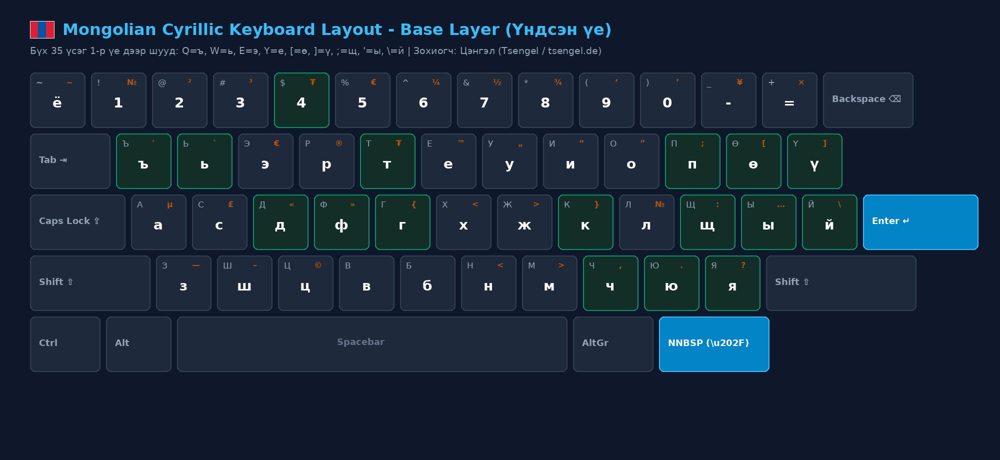
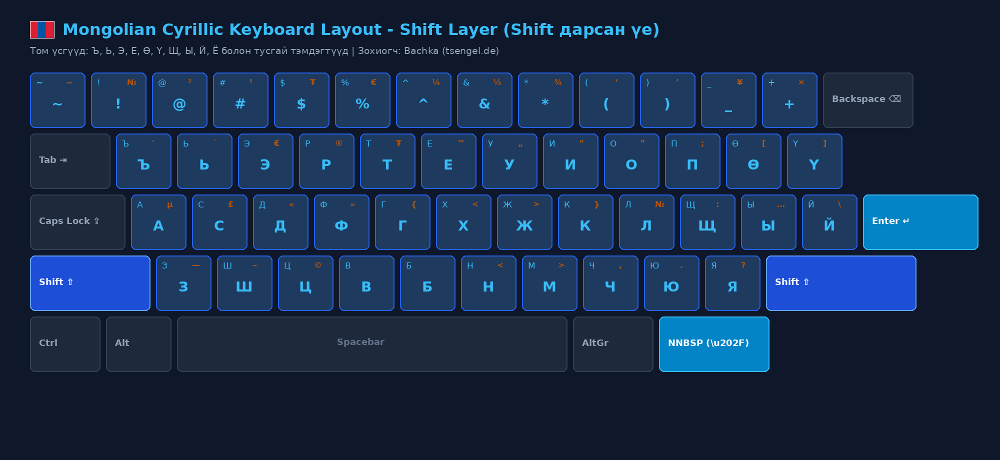
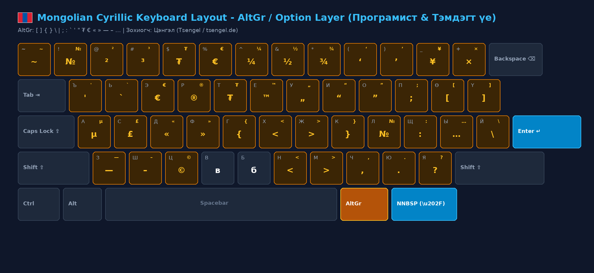
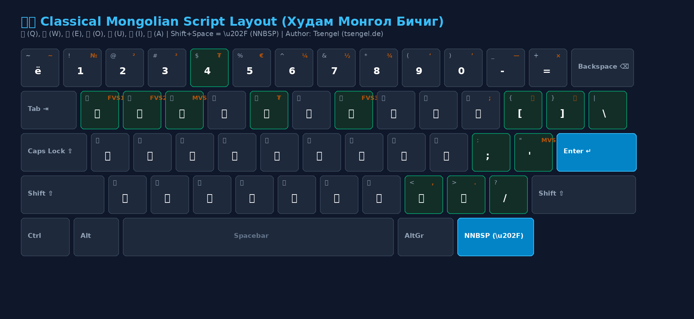

# 🇲🇳 Universal Mongolian Keyboard Layout Suite
### For Linux • macOS • Windows • Web

[](LICENSE)
[]()
[]()
[](https://ko-fi.com/tsengel)
[-red.svg)](https://tsengel.de)

**Languages:** [🇲🇳 Монгол](README.md) • [🇬🇧 English](README.en.md) • [🇩🇪 Deutsch](README.de.md)

> [!IMPORTANT]
> 🌿 **Non-Commercial • Public Commons**  
> **Voluntarily created for the public good.**  
> **Freely open to everyone** — Nobody profits from this work, and nobody is ever charged. Created purely during personal free time as an open-source public good to empower Mongolian typing worldwide.

> **"Typing in Mongolian should never be slow, frustrating, or complicated."**  
> A unified, high-speed, ergonomic keyboard layout suite designed for Mongolians worldwide, diaspora communities, developers, and language learners typing on US QWERTY and German QWERTZ keyboards.

---

## 🗺️ Layout Diagrams (All Layers Illustrated)

### 1. Base Layer (All 35 Mongolian Cyrillic Letters Directly Accessible)
> **Principle**: No Option/AltGr needed for letters. `Q = ъ`, `W = ь`, `Y = е`, `[ = ө`, `] = ү`, `; = щ`, `' = ы`, `\ = й`, `` ` = ё `` are mapped natively to Layer 1.



### 2. Shift Layer (Capitals & Punctuation)
> Capital letters (**`Ө, Ү, Ъ, Ь, Е, Щ, Ы, Й, Ё`**) and punctuation symbols.



### 3. AltGr / Option Extension Layer (Programmer Brackets & Official Symbols)
> Holding **Right Alt (AltGr)** or **macOS Option** gives instant access to code brackets (**`[ ] { } \ | ; : ' "`**), the official Tugrik symbol (**`₮`**), Euro (**`€`**), angle quotes (**`« »`**), and em-dash (**`—`**).



### 4. Traditional Script Edition (Classical Mongol Bichig — Bachka Phonetic Logic)
> Matches Cyrillic finger habits with 100% muscle memory: `[` = **ᠥ (Ö)**, `]` = **ᠦ (Ü)**, `E` = **ᠡ (E)**, `O` = **ᠣ (O)**, `U` = **ᠤ (U)**, `I` = **ᠢ (I)**, `A` = **ᠠ (A)**, `N` = **ᠨ (N)**, `Shift+N` = **ᠩ (Ag/Ng)**. Number keys type classical numerals (᠐-᠙). `Shift + Space` = **NNBSP** (`\u202F`).



---

## ⌨️ Key Mapping Reference

| Key | Base Layer | Shift Layer | AltGr / Option (Layer 3) | Notes |
|:---:|:---:|:---:|:---:|:---|
| `Q` | **ъ** | **Ъ** | `'` | Direct on base layer |
| `W` | **ь** | **Ь** | `` ` `` | Direct on base layer |
| `E` | **э** | **Э** | `€` | Euro sign |
| `R` | **р** | **Р** | `®` | Registered mark |
| `T` | **т** | **Т** | **₮ (U+20AE)** | Tugrik |
| `Y` | **е** | **Е** | `™` | **"е / Е" letter is here!** |
| `[` | **ө** | **Ө** | `[` | **ө on base, [ on AltGr** |
| `]` | **ү** | **Ү** | `]` | **ү on base, ] on AltGr** |
| `;` | **щ** | **Щ** | `:` | **щ on base, : on AltGr** |
| `'` | **ы** | **Ы** | `…` | **ы on base, … on AltGr** |
| `\` | **й** | **Й** | `\` | **й on base, \ on AltGr** |
| `` ` `` | **ё** | **Ё** | `~` | **ё on base, ~ on AltGr** |
| `G` | **г** | **Г** | `{` | Left brace |
| `K` | **к** | **К** | `}` | Right brace |
| `D` | **д** | **Д** | `«` | Left angle quote |
| `F` | **ф** | **Ф** | `»` | Right angle quote |
| `4` | 4 | $ | **₮** | Tugrik |
| `-` | - | _ | **—** | Em-dash |
| `,` | **ч** | **Ч** | `,` | **ч on base, comma on AltGr** |
| `.` | **ю** | **Ю** | `.` | **ю on base, period on AltGr** |
| `/` | **я** | **Я** | `?` | **я on base, question on AltGr** |
| `Space` | Space | Space | `\u202F` | **NNBSP (Narrow No-Break Space)** |
| `-` | - | - | _ | **— (Em-dash)** |
| `Space` | Space | Space | Space | **\u202F (NNBSP space)** |

---

## Installation Guides

### 🐧 1. Linux (Ubuntu, Debian, Fedora, Arch)
A single command installs the **Dual Layout Suite (Cyrillic & Traditional Script)** into system XKB:

```bash
cd linux
sudo ./install.sh
```

> [!IMPORTANT]
> **⚠️ Linux (GNOME / Wayland / Ubuntu) Users: Please LOG OUT and Log Back In or RESTART your system after installation!**
> GNOME Shell (especially under Wayland) caches XKB layout definitions once per user session on startup. Logging out and back in forces GNOME Shell to reload rules, after which **`mn`** (Cyrillic) and **`mgl`** (Classical Script) will appear distinctively in the top menu and toggle via `Super + Space`.

After installation, both layouts are available immediately:
1. **Default**: `Mongolian Cyrillic (Bachka)` — All 35 letters on Layer 1 (`Q=ъ, W=ь, Y=е, [=ө, ]=ү`)
2. **Traditional**: `Mongolian Script (Bachka)` — Phonetic mapping (`[=ᠥ, ]=ᠦ, A=ᠠ, E=ᠡ...`)

* **Terminal Switch (X11)**:
  - `setxkbmap mn` (Mongolian Cyrillic)
  - `setxkbmap mn -variant bichig` (Traditional Bichig)
* **Desktop (GNOME / Ubuntu / Fedora)**:
  - Go to `Settings` $\rightarrow$ `Keyboard` $\rightarrow$ `Input Sources` $\rightarrow$ Add `Mongolian`. Toggle anytime with **`Super + Space`** (Win + Space).
* **To Revert**: `cd linux && sudo ./uninstall.sh`.

---

### 🍏 2. macOS (Apple OS X / macOS)
Official Apple-standard `Mongolian.bundle` and installer for macOS:

* **Installation via Virtual Disk (.dmg — Recommended One-Click Method)**:
  1. Double-click `Mongolian-Keyboard-macOS-v1.0.3.dmg` to open it.
  2. Open **`Keyboard Installer.app`** inside and drag **`Mongolian.bundle`** into its window.
  3. *(Manual installation)*: Open Finder, press **Cmd + Shift + G**, navigate to `~/Library/Keyboard Layouts`, and copy `Mongolian.bundle` or `MongolianCyrillicErgonomic.keylayout` into it.
  4. **CRITICAL: You MUST Log Out of macOS and log back in (or Restart your Mac)**. macOS only compiles and caches keyboard layouts into memory during user login.
* **To Activate in macOS**:
  1. Go to `System Settings` $\rightarrow$ `Keyboard` $\rightarrow$ `Text Input` (Input Sources) $\rightarrow$ click `Edit...` (or `+`).
  2. Under `Mongolian`, select **`Mongolian Cyrillic Ergonomic (Tsengel)`** and click `Add`.
  3. The bundle also provides `Mongolian (qwerty)` and `Mongolian (traditional)` (Classical Mongol Bichig).

---

### 🪟 3. Windows (Windows 7 / 10 / 11)

#### A. Standalone All-in-One Installer (Recommended ⭐)
* Download and run **[Mongolian-Keyboard-Windows-Setup-v1.0.3.exe](https://mn.tsengel.de/downloads/Mongolian-Keyboard-Windows-Setup-v1.0.3.exe)**.
* Select your physical keyboard type (US QWERTY or German QWERTZ) and install TrueType Mongolian script fonts in a single wizard.
* Switch anytime using `Win + Space`.

#### B. PowerShell & Source Archive
* For silent or scripted installations:
  ```powershell
  cd windows
  .\install.ps1 -Base us    # For US English keyboards
  .\install.ps1 -Base de    # For German keyboards
  ```
* You can also inspect or modify the source layout file [windows/Mongolian-Ergonomic.klc](windows/Mongolian-Ergonomic.klc) using [Microsoft Keyboard Layout Creator (MSKLC)](https://www.microsoft.com/en-us/download/details.aspx?id=102134).

---

## Cryptographic Checksums (SHA-256)

Verify the integrity and authenticity of all release download packages:

```text
# 🪟 Windows (v1.0.3)
bf75103822f53bcd22e8bd7832743b16c6af9ea840e3dcc953604f04d0651ab0  Mongolian-Keyboard-Windows-Setup-v1.0.3.exe
3aeb1527f9b1b77ef6a0e6f74137be12ad974f88d891084f5bba100895b64f46  Mongolian-Keyboard-Windows-v1.0.3.zip

# 🍏 macOS (v1.0.3)
968a5019f5f3a5c563a842918b138a0a07f9f81df43bd94accf4e28194fcdbc3  Mongolian-Keyboard-macOS-v1.0.3.dmg
1ba0275e3dff0d96a9b74da437b83850bb65ca035a277d699e0154138e9fa177  Mongolian-Keyboard-macOS-v1.0.3.zip

# 🐧 Linux (v1.0.3)
70471279a0b025422ab5c74c4d9ede5212a82a6d40b36e77cec85c697f989809  Mongolian-Keyboard-Linux-v1.0.3.zip
ca3fe8b446baac512e38ed7ac7b58b52e7a07a2f08aeb19fe4778d43894253c9  install-linux.sh
```

---

## 🌐 Interactive Web Visualizer
Test the keyboard layout live in your browser without installing anything:
* **Live Web App:** [mn.tsengel.de](https://mn.tsengel.de) • [gar.tsengel.de](https://gar.tsengel.de) • [bichig.tsengel.de](https://bichig.tsengel.de)
* **Local Preview:**
```bash
xdg-open web/index.html
```

---

## Sources & Attribution

This 100% free, community-driven open-source initiative is built upon the invaluable heritage of earlier open-source efforts:
* **bachka-keyboard Work (Predecessors by Tsengel/Bachka)**:
  - [mongolian-keyboard-layout-linux](https://github.com/bachka/mongolian-keyboard-layout-linux) — Original Linux XKB symbols foundation
  - [mongolian-kbl-english-kb](https://github.com/bachka/mongolian-kbl-english-kb) — Windows US QWERTY installer and MSKLC source
  - [mongolian-kbl-german-kb](https://github.com/bachka/mongolian-kbl-german-kb) — Windows German QWERTZ installer and MSKLC source
* **StudyMongolian.net (Study Mongolian)**:
  - [StudyMongolian.net](https://www.studymongolian.net/technical/mongolian-keyboard-for-macos/) — Modern macOS `Mongolian.bundle` architecture, MacBook ANSI/JIS keyboard support, and Classical script layout design.
* **SIL International**:
  - [SIL International / Ukelele](https://software.sil.org/ukelele/) — macOS Unicode keyboard layout standards and the `Keyboard Installer.app` utility.
* **Dusal.net (D. Dusal)**:
  - [Dusal.net](http://dusal.blogmn.net/99944/) — Classical Mongolian script font (`cmdashitseden.ttf`) source.

---

## Support & Contribution

This is an unfunded, volunteer community effort developed during personal free time. If you find this keyboard suite helpful and wish to help cover domain, server, and hosting expenses:

[](https://ko-fi.com/tsengel)

---

## Author & License

This work is open-source under the [MIT License](LICENSE) freely available to everyone.
* Author & Maintainer: **Tsengel / Bachka** — [tsengel.de](https://tsengel.de) (also [blog.tsengel.de](https://blog.tsengel.de))
* Contributions, feedback, and improvements are welcome via GitHub Issues and Pull Requests.

