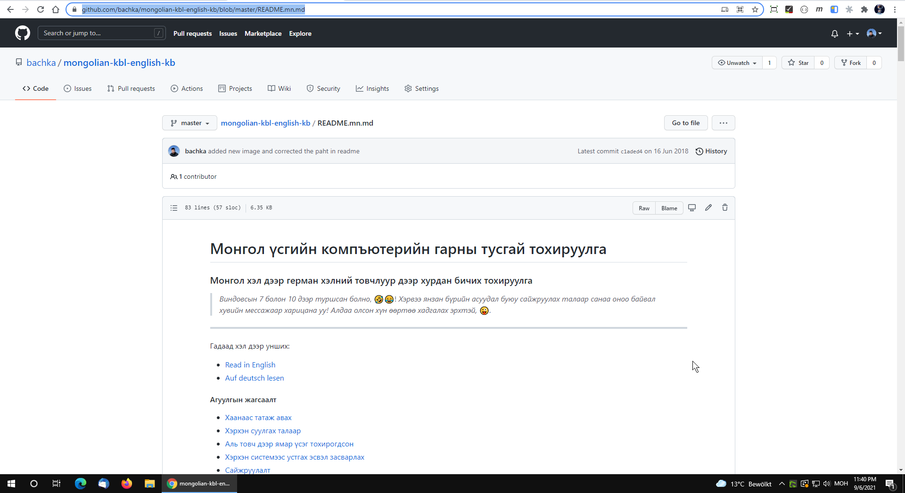
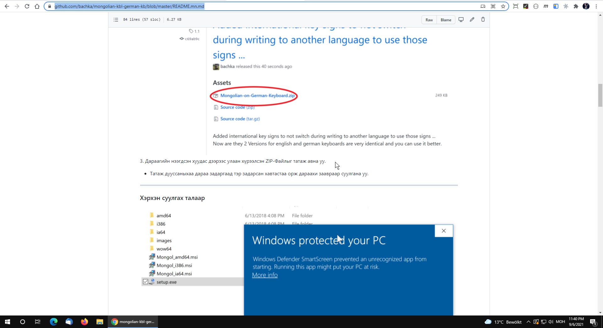

# 🇲🇳 Бүх Нийтийн Монгол Гарын Байрлал
### Universal Mongolian Keyboard Layout Suite (Linux • Windows • macOS • Web)

[](LICENSE)
[]()
[]()

> **"Монгол хэлээр бичих нь хэзээ ч адармаатай, удаан байх ёсгүй."**  
> Дэлхий даяарх бүх монголчууд, гадаад дахь диаспора, програмистууд, оюутан залуус ямар ч комьпютер дээр (US QWERTY болон German QWERTZ товчлуурт) монгол кирилл болон худам монгол бичгээр хурдан, эргономик, алдаагүй бичих нэгдсэн гарын стандарт.

---

## 💡 Яагаад энэ төсөл үүссэн бэ? (The Problem & Solution)

1. **Бичгийн машины хуучин загварын гацаа**: Анхны стандарт кирилл гарын байрлал нь 20-р зууны дунд үеийн бичгийн машины байрлалыг шууд хуулбарласан тул латин гар дээр 10 хуруугаар бичихэд авиа зүйн ямар ч уялдаагүй байдаг.
2. **Гадаадад суугаа Монголчууд & Програмистууд**: Өдөр тутмын амьдрал, ажил дээрээ US QWERTY эсвэл German QWERTZ гар ашигладаг хүмүүс монгол үсэг рүү шилжихэд үсэг хайж цаг алддаг.
3. **Өргөтгөсөн тэмдэгтүүдийн дутагдал**: Төгрөгийн тэмдэгт (`₮`), албан ёсны хашилт (`« »`, `“ ”`), зураас (`—`, `–`), болон Худам монгол бичгийн сул зай (`NNBSP \u202F`) стандарт гар дээр байдаггүй.
4. **Нэгдсэн шийдэл**: Энэхүү төсөл нь **Linux, Windows, macOS, Web** дээр яг ижилхэн, нэг авиа зүйн дүрмээр ажиллах бүрэн багц юм.

---

## 🗺️ Гарын Байршлын Зураглал (Layout Maps)

### Үндсэн ба Shift Байрлал (Normal & Shift States)


### AltGr Өргөтгөл Байрлал (AltGr / Option Layer: Төгрөг ₮, Хашилт, Зураас)


---

## 🚀 Суулгах Заавар (Installation Guides)

### 🐧 1. Linux (Ubuntu, Debian, Fedora, Arch)
Линукс систем дээр `XKB` стандартыг ашиглан нэг тушаалаар суулгана:

```bash
cd linux
sudo ./install.sh
```

* **Идэвхжүүлэх**: `Settings` $\rightarrow$ `Keyboard` $\rightarrow$ `Add Input Source` $\rightarrow$ `Mongolian`.
* **Буцааж хэвийн болгох**:
  ```bash
  cd linux
  sudo ./uninstall.sh
  ```

---

### 🪟 2. Windows (Windows 7 / 10 / 11)
Windows дээр Microsoft-ийн албан ёсны *MSKLC (Keyboard Layout Creator)* хэрэгслээр бэлтгэсэн суулгацуудыг ашиглана:

* **US English (QWERTY) суурьтай гар ашигладаг бол**:
  1. `windows/us-qwerty/` хавтас руу орно.
  2. `setup.exe` (эсвэл системийн архитектурт тохирсон `Mongol_amd64.msi`) дээр хоёр товшиж суулгана.
* **Герман (QWERTZ) суурьтай гар ашигладаг бол**:
  1. `windows/de-qwertz/` хавтас руу орно.
  2. `setup.exe` (эсвэл `mongolis_amd64.msi`) дээр хоёр товшиж суулгана.
* Суулгаж дууссаны дараа системийн хэл сонгох хэсгээс шууд сонгож ашиглана (`Win + Space`).

---

### 🍏 3. macOS (Apple OS X / macOS)
macOS-д зориулсан Кирилл болон Худам Монгол бичгийн `.keylayout` болон цэсний `.icns` дүрсүүд:

```bash
cd macos
./install.sh
```
*(Эсвэл Finder дээр `macos/install.command` файлыг хоёр товшиж ажиллуулна).*

* **Идэвхжүүлэх**:
  1. `System Settings` $\rightarrow$ `Keyboard` $\rightarrow$ `Text Input` (Input Sources) $\rightarrow$ `Edit`.
  2. `+` товч дээр дарж `Mongolian` хэсгээс:
     - `Mongolian Cyrillic Qwerty (Dusal)`
     - `Mongolian Script Qwerty (Dusal)` (Худам монгол бичиг)
  3. `Add` дарна.

---

### 🌐 4. Web / Онлайн Туршигч (Interactive Web Visualizer)
Та ямар нэг программ суулгахгүйгээр шууд хөтөч дээрээ гарын тохиргоог туршиж, бичиж үзэж болно:

```bash
# Хөтөч дээрээ нээх
xdg-open web/index.html
# эсвэл ямар ч web серверээр ажиллуулах
```

---

## ⌨️ Гол Үсэг, Тэмдэгтүүдийн Дүрэм (Key Mapping Principles)

| Латин товчлуур | Кирилл үсэг | Shift + Товчлуур | AltGr (Баруун Alt) |
|:---:|:---:|:---:|:---:|
| `A` | **а** | **А** | $\mu$ (микро) |
| `B` | **б** | **Б** | ° (градус) |
| `D` | **д** | **Д** | « (зүүн хашилт) |
| `F` | **ф** | **Ф** | » (баруун хашилт) |
| `E` | **е** | **Е** | € (Евро) |
| `T` | **т** | **Т** | **₮ (ТӨГРӨГ)** |
| `O` | **о** | **О** | " (давхар хашилт) |
| `[` | **ө** | **Ө** | [ |
| `]` | **ү** | **Ү** | ] |
| `-` | **-** | **_** | — (em-dash урт зураас) |
| `Space` | Зай | Зай | `\u202F` (NNBSP монгол бичгийн сул зай) |

---

## 📂 Төслийн бүтэц (Repository Structure)

```
mn-keyboard-layout/
├── README.md               # Энэхүү дэлгэрэнгүй гарын авлага
├── linux/                  # Линукс XKB тохиргоо ба суулгацын скриптүүд
│   ├── mn-custom           # XKB symbols файл (Tsengel)
│   ├── install.sh          # Нэг тушаалаар суулгагч
│   └── uninstall.sh        # Сэргээгч
├── windows/                # Windows MSI & setup.exe багцууд
│   ├── us-qwerty/          # Англи суурьтай Windows гар
│   └── de-qwertz/          # Герман суурьтай Windows гар
├── macos/                  # macOS .keylayout, дүрс, монгол бичгийн фонтууд
│   ├── fonts/              # MongolianScript.ttf, cmdashitseden.ttf
│   ├── icons/              # Цэсний .icns дүрсүүд
│   ├── install.sh          # macOS суулгагч
│   └── *.keylayout         # Кирилл ба Худам монгол бичгийн гарын файлууд
├── web/                    # Хөтөч дээр шууд турших интерактив веб хуудас
│   └── index.html
└── docs/                   # Зураг, диаграммууд
    └── images/
```

---

## 🤝 Хамтран ажиллах & Нээлттэй эрх (Contribution & License)

Энэхүү төсөл нь бүх монголчуудад чөлөөтэй нээлттэй [Apache License 2.0](LICENSE) эрхтэй.
* Санал хүсэлт, сайжруулалт байвал GitHub дээр Issue болон Pull Request нээнэ үү!
* Төслийн зохиогч: **Цэнгэл (Tsengel)** — [tsengel.de](https://tsengel.de)

*Монголын үрс маш олон болж, мэдлэгийг харамгүй хуваалцан хамтдаа хөгжих болтугай! 🇲🇳*

