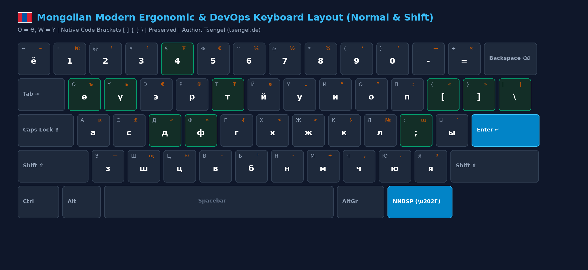
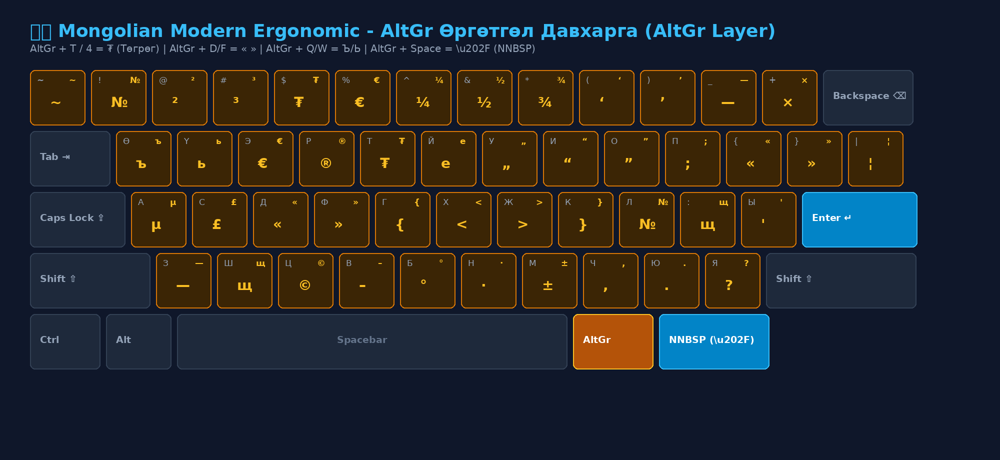
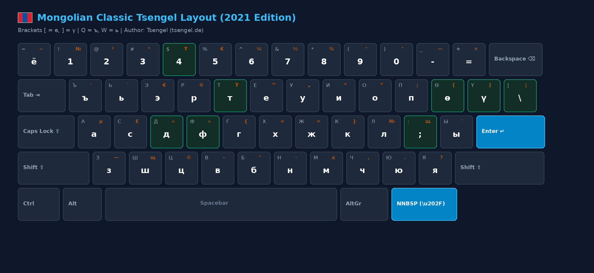
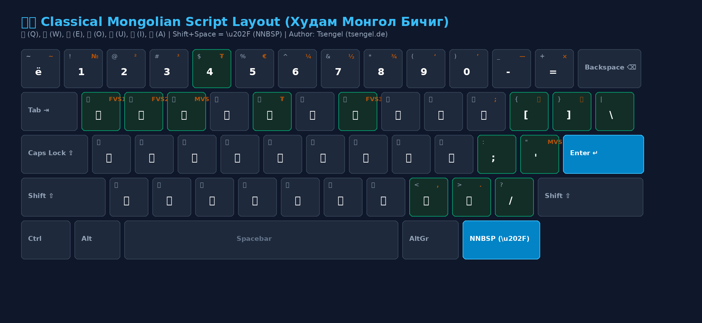

# 🇲🇳 Бүх Нийтийн Монгол Гарын Байрлал
### Universal Mongolian Keyboard Layout Suite (Linux • macOS • Windows • Web)

[](LICENSE)
[]()
[]()
[](https://ko-fi.com/tsengel)
[-red.svg)](https://tsengel.de)

**Хэл сонгох / Languages:** [🇲🇳 Монгол](README.md) • [🇬🇧 English](README.en.md) • [🇩🇪 Deutsch](README.de.md)

> **"Монгол хэлээр бичих нь хэзээ ч адармаатай, удаан байх ёсгүй."**  
> Дэлхий даяарх бүх монголчууд, гадаад дахь диаспора, инженерүүд, програмистууд ямар ч комьпютер дээр (US QWERTY болон German QWERTZ товчлуурт) монгол кирилл болон худам монгол бичгээр хурдан, эргономик, алдаагүй бичих нэгдсэн гарын стандарт.

---

## 🗺️ Гарын Байршлын Зураглалууд (Up-to-Date Layout Maps)

### 1. Modern Ergonomic Edition (Шинэ Эргономик Хувилбар)
> **Зөвлөмж**: `Q = Ө`, `W = Ү`. Бүх эгшгүүд гарын үндсэн хэсэгт багтсан тул 10 хуруугаар маш хурдан шивнэ. Кодчилол, терминалын `{ } [ ] | \` хаалтууд байрандаа хадгалагдсан.



### 2. AltGr Өргөтгөл Давхарга (AltGr / Option Layer: ₮, « », —, \u202F)
> Баруун `Alt` (AltGr) эсвэл Mac-ийн `Option` товчлуураар албан ёсны Төгрөгийн тэмдэгт (**`₮`**), хашилт (**`« »`**), урт зураас (**`—`**), болон Монгол бичгийн дагаврын сул зай (**`\u202F` NNBSP**) шууд гарна.



### 3. Classic Tsengel Edition (2021 Анхны Хувилбар)
> Эгшгийн эрэмбээр `[` $\rightarrow$ `ө`, `]` $\rightarrow$ `ү`, `Q` $\rightarrow$ `ъ`, `W` $\rightarrow$ `ь` тохируулсан хувилбар.



### 4. Classical Mongol Bichig Edition (Худам Монгол Бичиг)
> Кирилл үсгийн байрлалтай 100% ижил дадлаар Худам монгол бичгээр шивнэ: `Q` = **Ö (Ө)**, `W` = **Ü (Ү)**, `E` = **E (Э)**, `O` = **O (О)**, `U` = **U (У)**, `I` = **I (И)**, `A` = **A (А)**. Тоон товчлуурууд дээр монгол бичгийн сонгодог цифрүүд (0-9) шууд гарна. Дэлгэрэнгүй хуваарилалтыг доорх зургаас харна уу.



---

## ⌨️ Үсэг ба Тэмдэгтүүдийн Харьцуулсан Хүснэгт (Keymap Reference)

| Товчлуур | Ergonomic (Шинэ) | Classic (2021) | Shift + Товчлуур (Ergo) | AltGr (Баруун Alt) |
|:---:|:---:|:---:|:---:|:---:|
| `Q` | **ө** (Feminine O) | **ъ** | **Ө** | **ъ** (Хатуугийн тэмдэг) |
| `W` | **ү** (Feminine U) | **ь** | **Ү** | **ь** (Зөөлний тэмдэг) |
| `E` | **э** | **э** | **Э** | € (Евро) |
| `T` | **т** | **т** | **Т** | **₮ (ТӨГРӨГ \u20AE)** |
| `Y` | **й** | **е** | **Й** | **е** |
| `[` | **[** (Кодын хаалт) | **ө** | **{** (Кодын хаалт) | **«** (Зүүн хашилт) |
| `]` | **]** (Кодын хаалт) | **ү** | **}** (Кодын хаалт) | **»** (Баруун хашилт) |
| `\` | **\\** (Кодын зураас) | **й** | **\|** (Кодын Pipe) | **\|** |
| `;` | **;** | **щ** | **:** | **щ** |
| `'` | **ы** | **ы** | **Ы** | **'** / **"** |
| `4` | 4 | 4 | $ | **₮ (Төгрөг)** |
| `-` | - | - | _ | **— (Em-dash урт зураас)** |
| `Space` | Зай | Зай | Зай | **\u202F (NNBSP бичгийн зай)** |

---

## Суулгах Заавар (Installation Guides)

### 🐧 1. Linux (Ubuntu, Debian, Fedora, Arch)
Линукс систем дээр нэг тушаалаар **3 хувилбарыг бүгдийг нь нэгэн зэрэг** системд суулгана:

```bash
cd linux
sudo ./install.sh
```

Суулгасны дараа та дараах 3 хувилбарыг шууд ашиглах боломжтой болно:
1. **Үндсэн (Default)**: `Mongolian (Modern Ergonomic)` (`Q=Ө, W=Ү`)
2. **Classic**: `Mongolian (Classic Tsengel)` (`[=ө, ]=ү`)
3. **Монгол бичиг**: `Mongolian Script (Bichig)` (Худам монгол бичиг)

* **Шууд шилжүүлэх (Terminal / X11)**:
  - `setxkbmap mn` (Ergonomic үндсэн хувилбар)
  - `setxkbmap mn -variant classic` (Classic хувилбар)
  - `setxkbmap mn -variant bichig` (Худам монгол бичиг)
* **График орчин (GNOME / KDE / Ubuntu)**:
  - `Settings` $\rightarrow$ `Keyboard` $\rightarrow$ `Input Sources` $\rightarrow$ `Add 'Mongolian'` (3 хувилбараас хүссэнээ нэмээд `Win + Space`-ээр шилжинэ).
* **Буцааж анхны төлөвт оруулах**: `cd linux && sudo ./uninstall.sh`.

---

### 🍏 2. macOS (Apple OS X / macOS)
macOS-д зориулсан Apple албан ёсны стандартын `Mongolian.bundle` багц:

* **Виртуал дискээр суулгах (.dmg — Drag & Drop хамгийн хялбар арга)**:
  1. `Mongolian-Keyboard-macOS.dmg` файлыг давхар товшиж нээнэ. Finder-т **`Mongolian Keyboard`** нэртэй диск холбогдож нээгдэнэ (эсвэл Finder-ийн хажуугийн "Locations" цэснээс олно).
  2. Цонхон доторх **`Keyboard Layouts`** холбоос дээр 2 дарж хавтсыг Finder-ээр нээнэ.
  3. Нээгдсэн `Keyboard Layouts` хавтас руу **`Mongolian.bundle`** багцыг чирж хуулна (Шаардлагатай бол Mac нууц үгээ оруулан зөвшөөрнө).
  4. Буцаад `Mongolian Keyboard` диск цонх руугаа очиж, **`Fonts (System)`** холбоос дээр 2 дарж нээнэ.
  5. **`Fonts`** хавтас доторх фонт файлуудыг нээгдсэн `Fonts (System)` хавтас руу чирж хуулна.
  6. Суулгаж дууссаны дараа Finder-ийн Locations самбараас `Mongolian Keyboard` дискний ард байх **Eject (⏏️)** товч дээр дарж дискийг салгана (Unmount).
* **Terminal дээр (Эх кодоос)**:
  ```bash
  cd macos
  ./install.sh
  ```
* **macOS дээр шинэ гараа идэвхжүүлэх**:
  1. `System Settings` $\rightarrow$ `Keyboard` $\rightarrow$ `Text Input` (Input Sources) $\rightarrow$ `Edit...` товшино.
  2. Зүүн доод талын `+` товч дарж `Mongolian` хэсгээс сонгоно:
     - `Mongolian Cyrillic Ergonomic (Tsengel)` (Шинэ Ergonomic Q=Ө, W=Ү)
     - `Mongolian Cyrillic Qwerty (Dusal)` (Classic [=ө, ]=ү)
     - `Mongolian Script Qwerty (Dusal)` (Худам монгол бичиг)
  3. `Add` товч дарж нэмнэ. *(Шинээр суусан гарын драйвер жагсаалтад шууд харагдахгүй бол системээс 1 удаа Log Out хийгээд буцаж нэвтрэхэд 100% найдвартай гарч ирнэ).*

---

### 🪟 3. Windows (Windows 7 / 10 / 11)

#### А. Бие даасан бүрэн суулгагч (Single All-in-One Installer - Зөвлөмж болгох)
* **[Mongolian-Keyboard-Windows-Setup.exe](https://mn.tsengel.de/downloads/Mongolian-Keyboard-Windows-Setup.exe)** файлыг татаж аваад ажиллуулна.
* Суулгах явцдаа өөрийн гарны төрөл (US QWERTY эсвэл German QWERTZ) болон Монгол бичгийн TrueType фонтуудыг сонгон нэг товшилтоор суулгана.
* Суусны дараа `Win + Space` дараад шууд Монгол гарыг сонгон бичнэ.

#### Б. PowerShell скрипт эсвэл MSI эх сан
* Хэрэв консолоор суулгахыг хүсвэл:
  ```powershell
  cd windows
  .\install.ps1 -Base us    # Англи суурьтай Windows гар
  .\install.ps1 -Base de    # Герман суурьтай Windows гар
  ```
* Мөн [windows/Mongolian-Ergonomic.klc](windows/Mongolian-Ergonomic.klc) эх файлыг [Microsoft Keyboard Layout Creator (MSKLC)](https://www.microsoft.com/en-us/download/details.aspx?id=102134) программд нээж хүссэнээрээ өөрчлөх боломжтой.

---

## Аюулгүй Байдлын Шалгалт (Cryptographic Integrity & SHA-256)

Бүх системийн суулгацын файлуудыг татаж авахдаа эх хувьтайгаа 100% тохирч, вирусгүй цэвэр болохыг дараах шалгах нийлбэрээр (SHA-256) баталгаажуулж болно:

```text
# 🪟 Windows
72967d6b31fd4e7501a752ac4fcc0c5ef0819798725185b239b9fc1609dbc7e3  Mongolian-Keyboard-Windows-Setup.exe
6527ddc3d370cf7a775314b23f742ef196320f2700a4b63bdf3517a25496d8a2  Mongolian-Keyboard-Windows.zip

# 🍏 macOS
ae1ef0c9be107a5f5cb9a59a0752f56d0b5eebece0b1272471ff0f49bf7f7bd5  Mongolian-Keyboard-macOS.dmg
7d4a4f05fae5d8c0e1df4a6ee544a36d41cc43c01e9e632731af8e9c5d16e1f8  Mongolian-Keyboard-macOS.zip

# 🐧 Linux
f80cf44cd61691ba742cec33de169d54e02f5625a87880dbdc2cbfd373a16aed  Mongolian-Keyboard-Linux.zip
438a636ad6b155865c22e6c6bd8020409ba9a8f1d8357cc6126acf40ffa4b8a4  install-linux.sh
```

---

## 🌐 Вэб Туршигч (Interactive Web Visualizer)
Та юу ч суулгахгүйгээр хөтөч дээрээ шууд гарын тохиргоог туршиж, DevOps кодчилол шалгаж үзэж болно:
* **Шууд турших (Live Web App):** [mn.tsengel.de](https://mn.tsengel.de) • [gar.tsengel.de](https://gar.tsengel.de) • [bichig.tsengel.de](https://bichig.tsengel.de)
* **Локалоор нээх:**
```bash
xdg-open web/index.html
```

---

## 📂 Төслийн Бүтэц (Repository Structure)

```
mn-keyboard-layout/
├── README.md               # Дэлгэрэнгүй баталгаажсан гарын авлага
├── LICENSE                 # MIT License
├── index.html              # Вэб гар руу чиглүүлэгч үндсэн хуудас
├── .github/workflows/      # GitHub Pages автомат нийтлэгч workflow
├── docs/images/            # Шинэчлэгдсэн вектор ба PNG гарын зургууд
│   ├── layout-ergonomic-normal.png
│   ├── layout-ergonomic-altgr.png
│   ├── layout-classic-normal.png
│   └── layout-bichig.png
├── linux/                  # Линукс XKB тохиргоонууд ба суулгагч
│   ├── mn-ergonomic        # Modern Ergonomic (Q=Ө, W=Ү)
│   ├── mn-custom           # Classic Tsengel layout
│   ├── mn-bichig           # Classical Mongol Bichig
│   ├── install.sh          # Сонголттой автомат суулгагч
│   └── uninstall.sh
├── macos/                  # macOS Mongolian.bundle, .dmg ба эх файлууд
│   ├── Mongolian.bundle/   # Apple Native Keyboard Layout Bundle
│   ├── MongolianCyrillicErgonomic.keylayout
│   ├── MongolianCyrillicErgonomic.icns
│   ├── MongolianScriptQwertyDusal.keylayout
│   ├── install.sh          # Terminal суулгагч
│   └── fonts/              # Classical Mongolian OpenType фонтууд
├── windows/                # Windows MSI суулгацууд ба MSKLC .klc эх кодууд
│   ├── Mongolian-Ergonomic.klc
│   ├── install.ps1
│   ├── us-qwerty/          # Pre-compiled setup.exe & MSI (US QWERTY)
│   └── de-qwertz/          # Pre-compiled setup.exe & MSI (German QWERTZ)
└── web/                    # Онлайн интерактив туршилтын веб апп
    └── index.html
```

---

## Эх Сурвалж ба Талархал (Sources & Attribution)

Энэхүү төсөл нь өмнөх үеийн нээлттэй эхийн шийдлүүд болон туршлага дээр тулгуурлан хөгжүүлэгдсэн:
* **bachka-keyboard төслүүд (Predecessor Projects by Tsengel/Bachka)**:
  - [mongolian-keyboard-layout-linux](https://github.com/bachka/mongolian-keyboard-layout-linux) — Анхны Linux XKB layout суурь
  - [mongolian-kbl-english-kb](https://github.com/bachka/mongolian-kbl-english-kb) — Windows US QWERTY суулгац ба MSKLC эх код
  - [mongolian-kbl-german-kb](https://github.com/bachka/mongolian-kbl-german-kb) — Windows German QWERTZ суулгац ба MSKLC эх код
* **Dusal.net (Д. Дусал)**:
  - [Dusal.net / Dusal Bicheech](http://dusal.blogmn.net/99944/) — Монгол фонетик гарын байрлал (QWERTY) болон macOS дээрх худам монгол бичгийн эхний keylayout, фонтын анхдагч суурийг тавьсан D. Dusal (dusal.net)-д гүн талархал илэрхийлье.

---

## Төслийг Дэмжих (Support & Donation)

Хэрэв энэхүү гарын байрлалууд таны ажил, амьдралд тус болж байгаа бол төслийн хөгжүүлэлт болон дэд бүтцийг дэмжих боломжтой:

[](https://ko-fi.com/tsengel)

---

## Зохиогч & Нээлттэй Эрх (Author & License)

Энэхүү төсөл нь дэлхий даяарх бүх монголчуудад нээлттэй [MIT License](LICENSE) эрхтэй.
* Төслийн зохиогч: **Цэнгэл (Tsengel)** — [tsengel.de](https://tsengel.de) (мөн [blog.tsengel.de](https://blog.tsengel.de))
* Санал хүсэлт, сайжруулалтыг GitHub Issue болон Pull Request-ээр хүлээн авна.

*Монголын үрс маш олон болж, мэдлэгийг харамгүй хуваалцан хамтдаа хөгжих болтугай! 🇲🇳*
